# Chapter 2 Exercises — a growing ecosystem of finance agents

An isolated rebuild of **Chapter 2's six design patterns** as one evolving
codebase. Instead of six disconnected notebooks, the patterns are implemented
as **pluggable agents** that register into a shared core — so each new step
*reuses* the tools and memory layers of the steps before it, mirroring how the
book's own labs build on each other.

The chapter's patterns, plus two memory types the book only hints at:

| # | Step | Pattern / capability | Book lab |
|---|------|----------------------|----------|
| 1 | `basic_chatbot` | plain agent, no tools, no memory | — |
| 2 | `fundamental_retrieval_agent` | tool use / function calling | Lab 1 |
| 3 | `portfolio_rebalancing_agent` | working memory | Lab 2 |
| 4 | `persistent.py` storage tier | durable memory (survives restarts) | Lab 2 (deep dive) |
| 5 | `patterns/episodic_memory` | episodic memory, cross-session recall | Lab 3 |
| 6 | `patterns/semantic_memory` | semantic memory: facts distilled from episodes | new |
| 7 | `price_agent` | ReAct (OpenAI SDK, not LlamaIndex) | Lab 4 |
| 8a | `patterns/evaluator_optimizer` | generator + judge feedback loop | Lab 5 |
| 8b | `patterns/sequential_chain` | three-agent JSON contract chain | Lab 6 |

## Repository architecture

```mermaid
flowchart TB
    subgraph CLI["CLI (main.py)"]
        LIST["<b>list</b> — show registered agents/patterns"]
        CHAT["<b>chat &lt;agent&gt;</b> — interactive REPL"]
        RUN["<b>run &lt;pattern&gt; …</b> — execute a composition"]
    end

    subgraph CORE["core/ — shared scaffolding"]
        CONFIG["config.py<br/>env parsing · model · paths"]
        REG["registry.py<br/>the ecosystem index"]
        CH["repl.py<br/>generic interactive-loop host"]
    end

    subgraph AGENTS["specialist_agents/ — single agents (book names)"]
        A1["basic_chatbot.py"]
        A2["fundamental_retrieval_agent.py"]
        A3["portfolio_rebalancing_agent.py"]
        A4["price_agent.py"]
    end

    subgraph MEMORY["memory/ — storage layers"]
        M1["working.py<br/>SQLite session"]
        M2["persistent.py<br/>file-backed · disk Chroma"]
        M3["episodic.py<br/>Chroma collection"]
        M4["semantic.py<br/>facts + consolidate()"]
    end

    subgraph TOOLS["tools/ — @function_tool wrappers"]
        T1["fundamentals.py<br/>FMP ratios"]
        T2["market.py<br/>yfinance price"]
    end

    subgraph PATTERNS["patterns/ — compositions"]
        P1["episodic_memory.py"]
        P2["semantic_memory.py"]
        P3["evaluator_optimizer.py"]
        P4["sequential_chain.py"]
    end

    CONFIG --> REG
    LIST --> REG
    CHAT --> REG
    RUN --> REG
    REG --> AGENTS
    REG --> PATTERNS

    AGENTS --> CH
    AGENTS --> MEMORY
    AGENTS --> TOOLS
    PATTERNS --> AGENTS
    PATTERNS --> MEMORY
    PATTERNS --> TOOLS

    classDef core fill:#1f2430,stroke:#569cd6,color:#d4d4d4;
    classDef agents fill:#1f2430,stroke:#4ec9b0,color:#d4d4d4;
    classDef mem fill:#1f2430,stroke:#ce9178,color:#d4d4d4;
    classDef tools fill:#1f2430,stroke:#dcdcaa,color:#d4d4d4;
    classDef pat fill:#1f2430,stroke:#c586c0,color:#d4d4d4;
    class CONFIG,REG,CH core;
    class A1,A2,A3,A4 agents;
    class M1,M2,M3,M4 mem;
    class T1,T2 tools;
    class P1,P2,P3,P4 pat;
```



**Reading the diagram:** everything flows through the `registry`. Agents are
leaf capabilities (prompts + wiring); tools and memory are shared resources any
agent can use; patterns compose multiple agents in a fixed shape. Adding a step
to the ecosystem = writing one module + one `@register(...)` decorator. The
CLI's three verbs are the only outward surface.

> Naming note: the generic loop host is `core/repl.py`, while agent *identities*
> live in `specialist_agents/*.py`. One "serving counter" (repl), many "chefs"
> (agents).

## Layout

```
Exercises/
├── README.md                  ← you are here (architecture + ladder)
├── requirements.txt           ← pins the shared-env stack per step
├── .gitignore
├── main.py                    ← CLI: list | chat <agent>
├── core/
│   ├── config.py              ← shared env/model/paths (root .env)
│   ├── registry.py            ← agent & pattern index
│   └── repl.py                ← generic interactive-loop host
├── specialist_agents/         ← single agents, named after the book's
│   ├── basic_chatbot.py           (folder name avoids shadowing the SDK's
│   └── ...                       top-level `agents` package)
├── tools/                     ← @function_tool wrappers
├── memory/                    ← working · persistent · episodic · semantic
└── patterns/                  ← multi-agent compositions
```

## Why `specialist_agents/` and not `agents/`

The OpenAI Agents SDK exposes a top-level package named `agents`. A local
`agents/` folder inside this project would shadow it and break every SDK import
(`from agents import Agent` → resolves to our folder). Chapter 4's README hits
this exact trap; we sidestep it the same way they did.

## Requirements & environment

This package runs against the **shared environment at the repository root**
(base Python 3.12). `requirements.txt` pins the exact stack each step expects
but is not meant to be installed in isolation — install it once into the shared
env if that env is ever recreated:

```bash
pip install -r requirements.txt
```

All API keys live in the root `.env` (loaded automatically by
`core/config.py`). Steps implemented so far need only `OPENAI_API_KEY`.

## Running

Everything runs from inside `Exercises/`:

```bash
python main.py list                        # what's registered
python main.py chat basic_chatbot          # interactive chat
python main.py chat basic_chatbot --no-stream
```

## Current progress

```
[ ✓ ] 0. Scaffold + env probe            skeleton package, config, registry, CLI
[ ✓ ] 1. basic_chatbot                   gpt-4o-mini, interactive loop, NO tools/memory
[ ] 2. fundamental_retrieval_agent       + tool use  → live ratios (Lab 1)
[ ] 3. portfolio_rebalancing_agent       + working memory (Lab 2)
[ ] 4. persistent.py storage tier        memory survives restarts
[ ] 5. patterns/episodic_memory          cross-session recall (Lab 3)
[ ] 6. patterns/semantic_memory          consolidate episodes → facts
[ ] 7. price_agent                       ReAct reasoning trace (Lab 4)
[ ] 8a. patterns/evaluator_optimizer     two-agent feedback loop (Lab 5)
[ ] 8b. patterns/sequential_chain        three-agent JSON chain (Lab 6)
[ ] 9. Polish                            README ladder, root README link
```

## Disclaimer

For educational purposes only. Outputs are not investment advice.